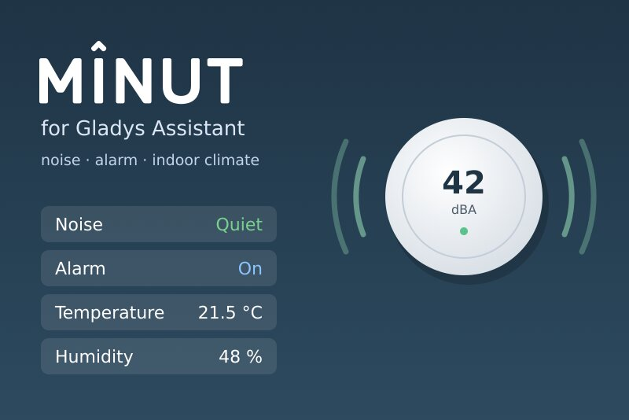
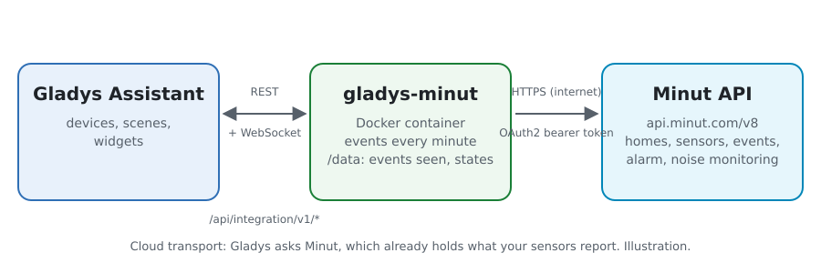
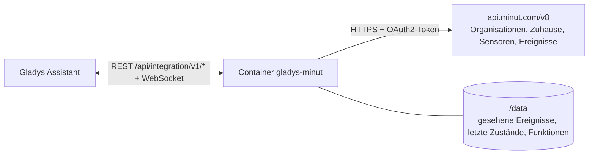
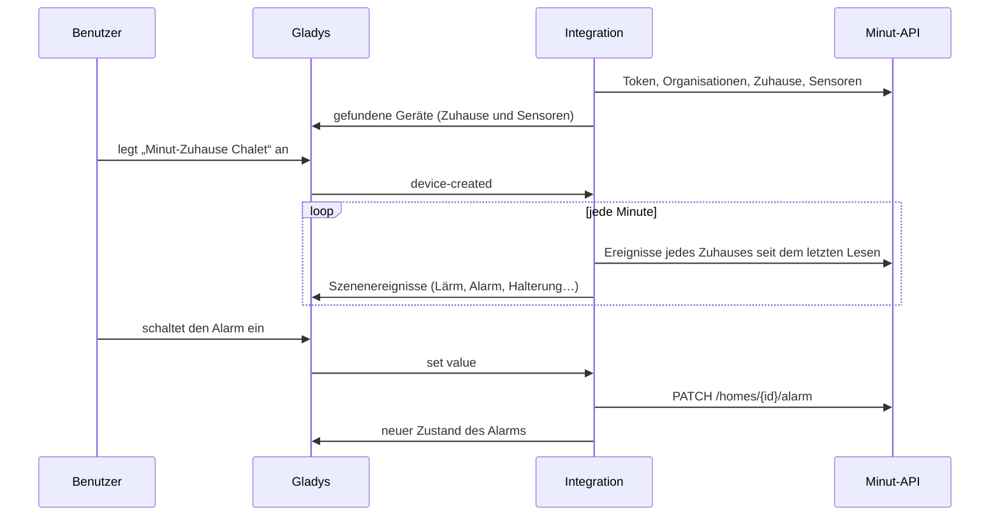
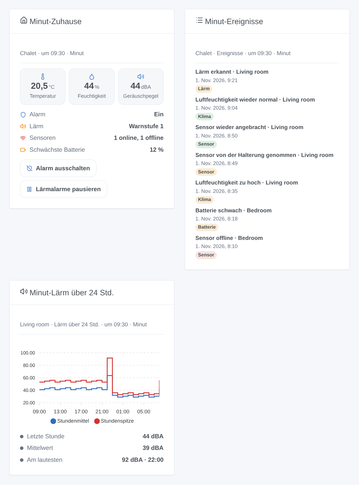

# Gladys Minut

[English](README.md) · [Français](README.fr.md) · **Deutsch** · [Español](README.es.md)

[](LICENSE)
[](https://github.com/William-De71/gladys-minut/releases)
[](https://github.com/William-De71/gladys-minut/actions/workflows/release.yml)
[](https://gladysassistant.com)



Externe Integration für [Gladys Assistant](https://gladysassistant.com) mit den Wohnungssensoren von **[Minut](https://www.minut.com)** (Minut Point und Nachfolger): Temperatur, Luftfeuchtigkeit, Geräuschpegel, Batterie, der Sicherheitsalarm und die Lärmüberwachung jedes Zuhauses, Szenen auf den Ereignissen, die Minut meldet, und Dashboard-Widgets. Sie liest die offizielle Minut-API mit einem OAuth2-Client deines Minut-Kontos.

> **Bevor du anfängst**: Minut öffnet seine API nur für Konten mit dem **Enterprise**-Tarif (sonst „Book a demo“ bei Minut). Diese Integration wurde nach der offiziellen API-Referenz geschrieben und **nie mit einem echten Minut-Konto getestet**: Rückmeldungen sind willkommen.

## Funktionen

- **Ein Gerät pro Minut-Sensor**: Temperatur, Luftfeuchtigkeit, Geräuschpegel (dBA), Luftdruck, Batterie, und „von der Halterung genommen“ bei den Sensoren, die es melden.
- **Ein Gerät pro Minut-Zuhause**: der Sicherheitsalarm (ein / aus, steuerbar), sein Zustand in Worten, die Lärmalarme (aktiv / pausiert, steuerbar) und der Zustand der Lärmüberwachung.
- **13 Szenenauslöser**, **4 Szenenaktionen** und **3 Dashboard-Widgets** (unten).
- Liest im Takt der Sensoren: die Ereignisse jedes Zuhauses jede Minute, die Zuhause alle 5 Minuten, die Sensoren bei ihrer nächsten erwarteten Meldung (5 bis 60 Minuten), immer unter dem Anfragelimit der API.
- Konfigurationstasten: verbinden und suchen, Diagnose.
- Vier Sprachen überall: Englisch, Französisch, Deutsch, Spanisch.

## Funktionsweise





Die Integration holt ein Token mit den Zugangsdaten deines Minut-API-Clients (`POST /oauth/token`) und erneuert es vor Ablauf. Sie listet deine Organisationen (`GET /organizations`), dann deren Zuhause und Sensoren (`GET /organizations/{id}/homes` und `/devices`: Die öffentliche Referenz dokumentiert keine Liste an der Wurzel). Minut-Sensoren laufen mit Batterien und melden sich etwa einmal pro Stunde, oder sofort, wenn etwas passiert: Sie öfter zu lesen bringt nichts, und Minut kann den Client sperren. Die Integration liest die Sensoren also bei ihrer nächsten Meldung (`next_heartbeat_at` + 2 Minuten, zwischen 5 und 60 Minuten), die Zuhause alle 5 Minuten und die Ereignisse jedes Zuhauses jede Minute (`GET /homes/{id}/events`); ein Ereignis zieht das nächste Lesen vor. Jede Anfrage läuft durch eine Warteschlange: 250 ms Abstand, höchstens 100 pro Minute (Minut erlaubt 120); ein 429 pausiert alles, 1 bis 30 Minuten.



### Transport

Nur Cloud (`"transports": ["cloud"]`): Der Katalog zeigt das Cloud-Abzeichen. Die Integration kontaktiert `api.minut.com` über HTTPS; Minut hat bereits, was deine Sensoren melden. Minut hat keine lokale API, daher gibt es keine Taste „Lokale Verbindung bevorzugen“. Webhooks bräuchten eine öffentliche HTTPS-Adresse: Version 0.1.0 liest stattdessen die Ereignisse.

## Geräte und Funktionen

| Gerät         | Funktion                   | Kategorie / Typ      | Hinweis                                                |
| ------------- | -------------------------- | -------------------- | ------------------------------------------------------ |
| Minut-Sensor  | Temperatur                 | `temperature-sensor` | °C                                                     |
| Minut-Sensor  | Luftfeuchtigkeit           | `humidity-sensor`    | %                                                      |
| Minut-Sensor  | Geräuschpegel              | `noise-sensor`       | dB (von Minut A-bewertet), ganze Zahl                  |
| Minut-Sensor  | Luftdruck                  | `pressure-sensor`    | hPa, wenn der Sensor ihn liefert                       |
| Minut-Sensor  | Batterie                   | `battery`            | %, wenn Minut sie liefert                              |
| Minut-Sensor  | Von der Halterung genommen | `tamper/binary`      | 1 außerhalb der Halterung, nur neuere Sensoren         |
| Minut-Zuhause | Alarm                      | `switch/binary`      | steuerbar: ein / aus                                   |
| Minut-Zuhause | Alarmstatus                | `text/text`          | ein, aus, wird eingeschaltet, Karenzzeit, ausgelöst    |
| Minut-Zuhause | Lärmüberwachung            | `switch/binary`      | steuerbar: aktiv / pausiert für die eingestellte Dauer |
| Minut-Zuhause | Lärmstörung                | `text/text`          | ruhig, Warnstufe 1 bis 4, pausiert, aus                |

`should_poll: false` (die Integration hat ihren eigenen Timer). Eine Funktion wird angeboten, sobald Minut ihren Wert geliefert hat, und verschwindet nie; ein Wert, den Minut nicht geliefert hat, wird nicht veröffentlicht. Die externen IDs kommen von den Minut-IDs. Es gibt keine Funktion „online“ (Gladys hat dafür keine Kategorie): Der Auslöser **Sensor offline oder zurück** und das Zuhause-Widget übernehmen das. Bewegung steht nicht in den Zuhause-Ereignissen der API und wird nicht unterstützt.

## Szenenauslöser, Aktionen und Widgets



**Auslöser** (Filter: Zuhause, Sensor, Zustand; die Variablen liefern die Namen, den Minut-Ereignistyp, seine Uhrzeit und seinen Titel)

- **Lärmstörung**: Lärm über der Schwelle der Lärmüberwachung (`noise_detected`) oder dessen Ende (`noise_quieted`), mit Geräuschpegel und Schwelle.
- **Rauch- oder CO-Alarm gehört**: Ein Sensor erkennt den Ton eines Melders (`alarm_heard`).
- **Sicherheitsalarm**: nach einer Bewegung ausgelöst, stummgeschaltet oder am Sensor stumm gestellt.
- **Alarm ein- oder ausgeschaltet** außerhalb von Gladys (Minut-App, Zeitplan): nie nach einem Befehl von Gladys.
- **Sensor abgenommen**: abgenommen, wieder angebracht oder Gehäuse geöffnet.
- **Sensor offline oder zurück**, **Batterie schwach** (schwach, leer).
- **Temperaturwarnung** (zu hoch, zu niedrig, wieder normal, fast Frost), **Feuchtigkeitswarnung** (zu hoch, zu niedrig, wieder normal) auf den in Minut eingestellten Schwellen, **Schimmelgefahr** (erkannt, vorbei).
- **Sensortaste gedrückt**, **Rauchen erkannt**, **Menschenmenge erkannt**.

**Aktionen**: Alarm ein- oder ausschalten; Alarm stummschalten; Lärmalarme pausieren oder fortsetzen (für eine Anzahl Minuten); Status eines Zuhauses lesen (Alarm, Lärm, Sensoren online, mittlere Temperatur und Luftfeuchtigkeit, lautester Pegel, schwächste Batterie und ein Satz `summary`). Keine davon löst einen Auslöser aus.

**Widgets**: **Minut-Zuhause** (Alarm, Lärm, Sensoren, schwächste Batterie, Temperatur, Feuchtigkeit, Geräusch, mit den Alarm- und Lärmtasten), **Minut-Ereignisse** (die letzten Ereignisse eines Zuhauses) und **Minut-Lärm über 24 Std.** (Stundenmittel und -spitze eines Sensors).

**Beispiele**

- Wenn **eine Lärmstörung beginnt** in der Ferienwohnung → eine Nachricht an den Gastgeber und blinkende Flurlichter; wenn sie **endet** → eine Bestätigung.
- Wenn **ein Rauch- oder CO-Alarm gehört wird** → alle Lichter an und eine Benachrichtigung, auch unterwegs.
- Wenn **das Haus leer wird** (Anwesenheit in Gladys) → **den Minut-Alarm einschalten**; wenn jemand zurückkommt → aus.

## Voraussetzungen

- Gladys Assistant **5.3.0** oder neuer (Katalog-Schlüsselwörter). Ältere Instanzen können die Integration nicht installieren.
- Minut-Sensoren, eingerichtet in der Minut-App, auf einem Konto mit **API-Zugang** (Minut-Tarif **Enterprise**).
- Ein API-Client dieses Kontos: Minut-Web-App → Settings → [Developer tools](https://web.minut.com/settings/api-clients) (siehe [docs/de.md](docs/de.md#api-client-anlegen)).

## Installation

- **Aus dem Store** von Gladys (Integrationen → Externe Integrationen), mit einem Klick, sobald indexiert.
- **Über die URL des Repositorys**: `https://github.com/William-De71/gladys-minut`.
- **Entwicklermodus**: das Image lokal bauen (`docker build -t gladys-minut .`) und in Gladys installieren.

## Konfiguration

| Feld                           | Standard    | Rolle                                                                    |
| ------------------------------ | ----------- | ------------------------------------------------------------------------ |
| Client-ID                      | —           | Die ID deines Minut-API-Clients.                                         |
| Client-Secret                  | —           | Sein Secret (geheimes Feld: nie wieder angezeigt oder geloggt).          |
| Pause der Lärmalarme (Minuten) | 60          | Wie lange das Ausschalten der Lärmüberwachung sie pausiert (5 bis 1440). |
| Sprache der Texte              | automatisch | Gerätenamen und Szenentexte.                                             |

## Verwendung

1. Gib Client-ID und Secret ein und speichere.
2. Drück **Verbinden und suchen**: Der Client wird geprüft, deine Zuhause und Sensoren werden aufgelistet.
3. Leg im Tab **Entdecken** die Geräte „Minut-Zuhause …“ und „Minut …“ an.
4. Füg die Widgets **Minut-Zuhause**, **Minut-Ereignisse** und **Minut-Lärm über 24 Std.** einem Dashboard hinzu und erstelle Szenen mit den Auslösern oben.

## Entwicklung

```bash
npm install
npm test                       # node --test, nie Netzwerkzugriff
npm run lint && npm run format:check
npx github:GladysAssistant/integration-store . --skip-image-check
scripts/build-cover.sh         # cover.jpg aus docs/assets/cover.svg
docs/illustrations/render.sh   # docs/assets/widgets.<sprache>.png
node .github/scripts/release.mjs next
```

Lokal liest das SDK `GLADYS_HOST_API_URL`, `GLADYS_INTEGRATION_TOKEN` und `GLADYS_INTEGRATION_SELECTOR`; `DEBUG=gladys-integration-sdk` zeigt die SDK-Logs und prüft jeden Widget-Inhalt. Die Tests liefern Antworten nach der [Referenz der Minut-API](https://api.minut.com/latest/docs) und den Beispielen ihrer [Anleitungen](https://developer.minut.com) (`test/fixtures/`, `test/helpers/fake-api.js`). Die Regeln des Projekts stehen in [CLAUDE.md](CLAUDE.md).

## Release-Prozess


Jeder Merge auf `main` startet die CI und berechnet dann die Version aus den [Conventional Commits](https://www.conventionalcommits.org/de/) seit dem letzten Tag: `feat` → Minor, `fix` / `perf` → Patch, `!` oder `BREAKING CHANGE` → Major (ein Minor unter 1.0.0); `docs`, `chore`, `ci`, `test`, `style`, `refactor`, `build` allein veröffentlichen nichts. Der Changelog-Abschnitt wird erzeugt, der Tag gepusht, das Multi-Architektur-Image gebaut, dann erhält `main` den Release-Commit, das GitHub Release wird erstellt und ein letzter Job prüft das öffentliche Image, den Store-Validator und das Topic.

- Der Titel des Pull Requests wird zum Squash-Commit, dann zur Changelog-Zeile: Schreib ihn auf Englisch, für den Benutzer (`pr-title.yml` prüft ihn). Bearbeite `CHANGELOG.md` nie von Hand.
- 1.0.0 ist eine Entscheidung: Actions → Release → Run workflow mit `release-as: 1.0.0`. `dry-run` zeigt Version und Notizen, ohne zu veröffentlichen.
- **Geschützter Branch**: Das Release pusht seinen Commit mit `GITHUB_TOKEN` auf `main`. Mit einem Ruleset, das Pull Requests oder Status Checks auf `main` verlangt, füg GitHub Actions zur Bypass-Liste hinzu (oder push über eine GitHub App), sonst schlägt der Publish-Job mit Anweisungen fehl.
- Mach nach dem ersten Release das Paket auf `ghcr.io` öffentlich (Package settings → Change visibility), sonst kann Gladys es nicht laden.

## Fehlerbehebung

Siehe [docs/de.md](docs/de.md#fehlerbehebung). Melde Probleme mit den Versionen von Gladys und der Integration, deinem Minut-Tarif und den Zeilen der Taste **Diagnose**.

## Mitwirken

Issues und Pull Requests sind willkommen. Führ `npm run format:check && npm run lint && npm test` aus, bevor du einen Pull Request öffnest, und lass jede externe ID und jeden gespeicherten Schlüssel unverändert (siehe [CLAUDE.md](CLAUDE.md)).

## Sicherheit

Siehe [SECURITY.md](SECURITY.md): Melde Schwachstellen vertraulich. Das Client-Secret ist ein `secret`-Feld von Gladys, wird nur über HTTPS an `api.minut.com` gesendet (Basic-Authentifizierung der Token-Anfrage), nie in die Logs oder eine Fehlermeldung geschrieben; das Zugriffstoken bleibt im Speicher. Die Integration läuft als Benutzer ohne Root-Rechte in einem schreibgeschützten Container.

## Kommende Screenshots

Die Bilder oben sind Illustrationen, keine Screenshots. Echte Screenshots kommen nach `docs/assets/screenshots/` (PNG, 1280 × 800): `configuration.png`, `discovery.png`, `device.png`, `scene.png`.

## Lizenz

[Apache-Lizenz 2.0](LICENSE) — siehe auch [NOTICE](NOTICE). Minut und das Minut-Logo sind Marken ihres Inhabers; diese Community-Integration ist nicht mit Minut verbunden und wird von Minut weder unterstützt noch gesponsert. Danke an die Dokumentation und das SDK von Gladys sowie an Minut für die öffentliche Dokumentation seiner API.
