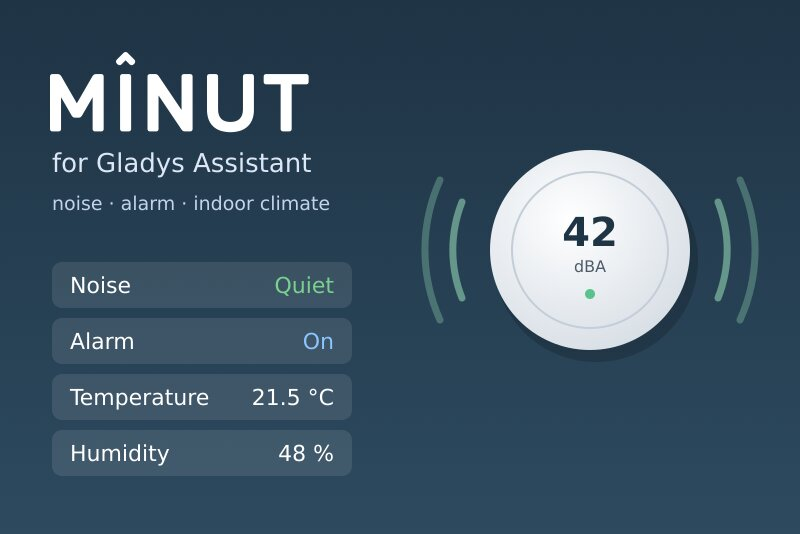
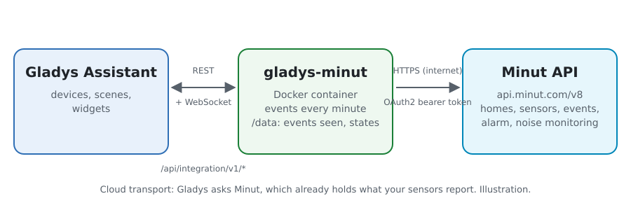
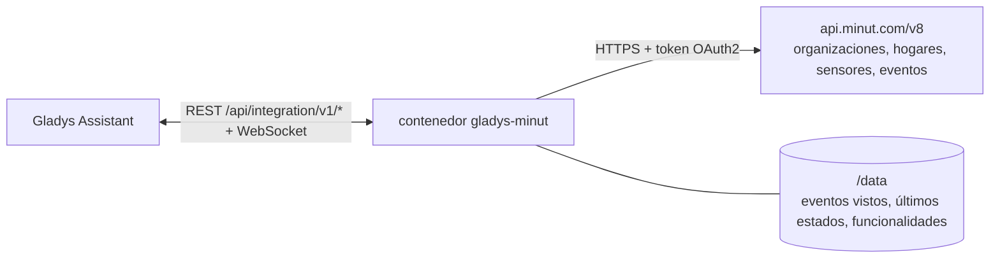
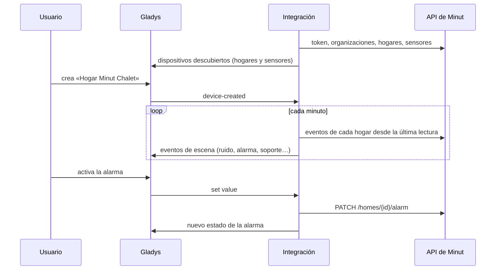
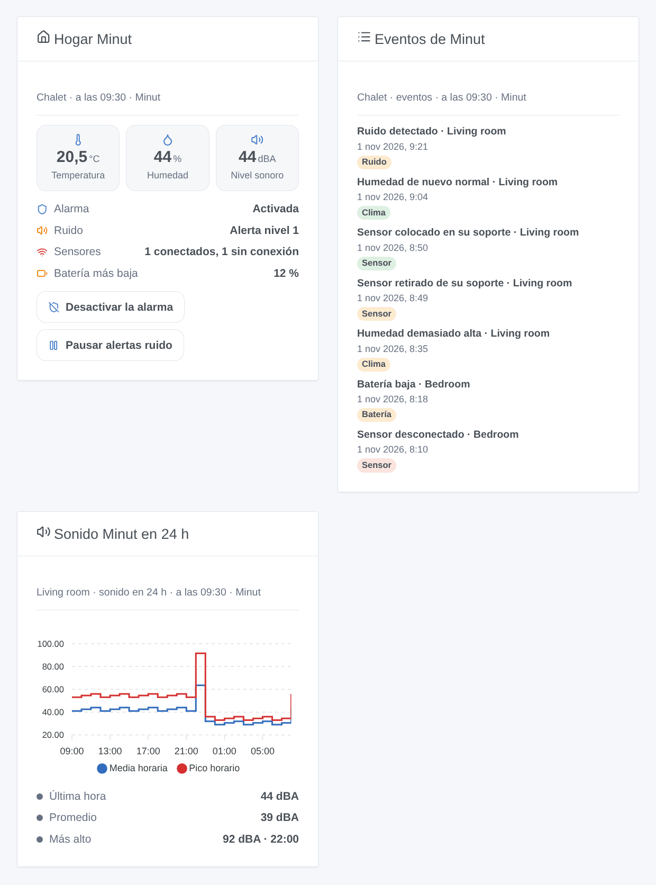

# Gladys Minut

[English](README.md) · [Français](README.fr.md) · [Deutsch](README.de.md) · **Español**

[](LICENSE)
[](https://github.com/William-De71/gladys-minut/releases)
[](https://github.com/William-De71/gladys-minut/actions/workflows/release.yml)
[](https://gladysassistant.com)



Integración externa de [Gladys Assistant](https://gladysassistant.com) para los sensores de vivienda **[Minut](https://www.minut.com)** (Minut Point y sus sucesores): temperatura, humedad, nivel sonoro, batería, la alarma de seguridad y la vigilancia del ruido de cada hogar, escenas sobre los eventos que Minut comunica, y widgets para el panel. Lee la API oficial de Minut con un cliente OAuth2 de su cuenta Minut.

> **Antes de empezar**: Minut solo abre su API a las cuentas de su plan **Enterprise** (si no, «book a demo» con Minut). Esta integración se escribió a partir de la referencia oficial de la API y **nunca se ha probado con una cuenta Minut real**: sus comentarios son bienvenidos.

## Funcionalidades

- **Un dispositivo por sensor Minut**: temperatura, humedad, nivel sonoro (dBA), presión, batería y «retirado de su soporte» en los sensores que lo indican.
- **Un dispositivo por hogar Minut**: la alarma de seguridad (activada / desactivada, controlable), su estado en palabras, las alertas de ruido (activas / en pausa, controlables) y el estado de la vigilancia del ruido.
- **13 desencadenantes de escena**, **4 acciones de escena** y **3 widgets** (abajo).
- Lectura al ritmo de los sensores: los eventos de cada hogar cada minuto, los hogares cada 5 minutos, los sensores en su próximo informe previsto (de 5 a 60 minutos), siempre por debajo del límite de solicitudes de la API.
- Botones de configuración: conectar y buscar, diagnóstico.
- Cuatro idiomas en todas partes: inglés, francés, alemán, español.

## Funcionamiento





La integración obtiene un token con las credenciales de su cliente de la API de Minut (`POST /oauth/token`), renovado antes de que caduque. Lista sus organizaciones (`GET /organizations`) y luego sus hogares y sensores (`GET /organizations/{id}/homes` y `/devices`: la referencia pública no documenta ninguna lista en la raíz). Los sensores Minut funcionan con pilas e informan aproximadamente una vez por hora, o de inmediato cuando ocurre algo: leerlos más a menudo no aporta nada y Minut puede bloquear el cliente. Por eso la integración lee los sensores en su próximo informe (`next_heartbeat_at` + 2 minutos, entre 5 y 60 minutos), los hogares cada 5 minutos y los eventos de cada hogar cada minuto (`GET /homes/{id}/events`); un evento adelanta la siguiente lectura. Todas las solicitudes pasan por una cola: 250 ms de separación, 100 por minuto como máximo (Minut permite 120); un 429 lo pausa todo, de 1 a 30 minutos.



### Transporte

Solo nube (`"transports": ["cloud"]`): el catálogo muestra la insignia de nube. La integración contacta con `api.minut.com` por HTTPS; Minut ya tiene lo que sus sensores informan. Minut no tiene API local, así que no hay botón «Preferir la conexión local». Los webhooks necesitarían una dirección HTTPS pública: la versión 0.1.0 lee los eventos en su lugar.

## Dispositivos y funcionalidades

| Dispositivo  | Funcionalidad          | Categoría / tipo     | Nota                                                             |
| ------------ | ---------------------- | -------------------- | ---------------------------------------------------------------- |
| Sensor Minut | Temperatura            | `temperature-sensor` | °C                                                               |
| Sensor Minut | Humedad                | `humidity-sensor`    | %                                                                |
| Sensor Minut | Nivel de sonido        | `noise-sensor`       | dB (ponderado A por Minut), número entero                        |
| Sensor Minut | Presión atmosférica    | `pressure-sensor`    | hPa, cuando el sensor la da                                      |
| Sensor Minut | Batería                | `battery`            | %, cuando Minut la da                                            |
| Sensor Minut | Retirado de su soporte | `tamper/binary`      | 1 fuera de su soporte, solo sensores recientes                   |
| Hogar Minut  | Alarma                 | `switch/binary`      | controlable: activada / desactivada                              |
| Hogar Minut  | Estado de la alarma    | `text/text`          | activada, desactivada, activándose, periodo de gracia, disparada |
| Hogar Minut  | Vigilancia del ruido   | `switch/binary`      | controlable: activa / en pausa durante el tiempo fijado          |
| Hogar Minut  | Molestia por ruido     | `text/text`          | tranquilo, alerta nivel 1 a 4, en pausa, desactivada             |

`should_poll: false` (la integración tiene su propio temporizador). Una funcionalidad se ofrece en cuanto Minut da su valor y nunca desaparece; un valor que Minut no dio no se publica. Los identificadores externos vienen de los identificadores de Minut. No hay funcionalidad «conectado» (Gladys no tiene categoría para ello): el desencadenante **sensor desconectado o de vuelta** y el widget del hogar lo cubren. El movimiento no está en los eventos de hogar de la API y no se gestiona.

## Desencadenantes, acciones y widgets



**Desencadenantes** (filtros: hogar, sensor, estado; las variables dan los nombres, el tipo de evento de Minut, su hora y su título)

- **Molestia por ruido**: un ruido por encima del umbral de la vigilancia del ruido (`noise_detected`), o su fin (`noise_quieted`), con el nivel sonoro y el umbral.
- **Alarma de humo o CO oída**: un sensor reconoce el sonido de un detector (`alarm_heard`).
- **Alarma de seguridad**: disparada tras un movimiento, silenciada o apagada en un sensor.
- **Alarma activada o desactivada** fuera de Gladys (app Minut, programación): nunca tras una orden enviada por Gladys.
- **Sensor retirado**: retirado, colocado de nuevo o carcasa abierta.
- **Sensor desconectado o de vuelta**, **batería baja** (baja, agotada).
- **Alerta de temperatura** (demasiado alta, demasiado baja, de nuevo normal, casi bajo cero), **alerta de humedad** (demasiado alta, demasiado baja, de nuevo normal) sobre los umbrales definidos en Minut, **riesgo de moho** (detectado, terminado).
- **Botón del sensor pulsado**, **se detectó que se fuma**, **aglomeración detectada**.

**Acciones**: activar o desactivar la alarma; silenciar la alarma; pausar o reanudar las alertas de ruido (durante unos minutos); leer el estado de un hogar (alarma, ruido, sensores conectados, temperatura y humedad medias, sonido más alto, batería más baja y una frase `summary`). Ninguna dispara un desencadenante.

**Widgets**: **Hogar Minut** (alarma, ruido, sensores, batería más baja, temperatura, humedad, sonido, con los botones de alarma y de ruido), **Eventos de Minut** (los últimos eventos de un hogar) y **Sonido Minut en 24 h** (media y pico por hora de un sensor).

**Ejemplos**

- Cuando **empieza una molestia por ruido** en el alquiler → un mensaje al anfitrión y las luces de la entrada parpadeando; cuando **termina** → una confirmación.
- Cuando **se oye una alarma de humo o CO** → todas las luces encendidas y una notificación, incluso a distancia.
- Cuando **la casa se queda vacía** (presencia de Gladys) → **activar la alarma Minut**; cuando alguien vuelve → desactivarla.

## Requisitos

- Gladys Assistant **5.3.0** o posterior (palabras clave del catálogo). Las instancias más antiguas no pueden instalar la integración.
- Sensores Minut configurados en la app Minut, en una cuenta con **acceso a la API** (plan Minut **Enterprise**).
- Un cliente de API de esa cuenta: app web de Minut → Settings → [Developer tools](https://web.minut.com/settings/api-clients) (ver [docs/es.md](docs/es.md#crear-el-cliente-de-api)).

## Instalación

- **Desde la tienda** de Gladys (Integraciones → Integraciones externas), con un clic, una vez indexada.
- **Desde la URL del repositorio**: `https://github.com/William-De71/gladys-minut`.
- **Modo desarrollador**: construya la imagen en local (`docker build -t gladys-minut .`) e instálela desde Gladys.

## Configuración

| Campo                               | Por defecto | Función                                                                   |
| ----------------------------------- | ----------- | ------------------------------------------------------------------------- |
| Id del cliente                      | —           | El id de su cliente de la API de Minut.                                   |
| Secreto del cliente                 | —           | Su secreto (campo secreto: nunca se vuelve a mostrar ni se registra).     |
| Pausa de alertas de ruido (minutos) | 60          | Cuánto dura la pausa al desactivar la vigilancia del ruido (de 5 a 1440). |
| Idioma de los textos                | automático  | Nombres de los dispositivos y textos de las escenas.                      |

## Uso

1. Introduzca el id y el secreto del cliente y guarde.
2. Pulse **Conectar y buscar**: se comprueba el cliente y se listan sus hogares y sensores.
3. En la pestaña **Descubrir**, cree los dispositivos «Hogar Minut …» y «Minut …».
4. Añada los widgets **Hogar Minut**, **Eventos de Minut** y **Sonido Minut en 24 h** a un panel y cree escenas con los desencadenantes de arriba.

## Desarrollo

```bash
npm install
npm test                       # node --test, nunca accede a la red
npm run lint && npm run format:check
npx github:GladysAssistant/integration-store . --skip-image-check
scripts/build-cover.sh         # cover.jpg desde docs/assets/cover.svg
docs/illustrations/render.sh   # docs/assets/widgets.<idioma>.png
node .github/scripts/release.mjs next
```

En local, el SDK lee `GLADYS_HOST_API_URL`, `GLADYS_INTEGRATION_TOKEN` y `GLADYS_INTEGRATION_SELECTOR`; `DEBUG=gladys-integration-sdk` muestra los registros del SDK y comprueba cada contenido de widget. Las pruebas sirven respuestas construidas según la [referencia de la API de Minut](https://api.minut.com/latest/docs) y los ejemplos de sus [guías](https://developer.minut.com) (`test/fixtures/`, `test/helpers/fake-api.js`). Las reglas del proyecto están en [CLAUDE.md](CLAUDE.md).

## Proceso de publicación


Cada fusión en `main` ejecuta la CI y luego calcula la versión a partir de los [Conventional Commits](https://www.conventionalcommits.org/es/) desde la última etiqueta: `feat` → menor, `fix` / `perf` → parche, `!` o `BREAKING CHANGE` → mayor (una menor por debajo de 1.0.0); `docs`, `chore`, `ci`, `test`, `style`, `refactor`, `build` solos no publican nada. Se genera la sección del changelog, se sube la etiqueta, se construye la imagen multiarquitectura, luego `main` recibe el commit de publicación, se crea la GitHub Release y un último trabajo comprueba la imagen pública, el validador de la tienda y el topic.

- El título de la pull request se convierte en el commit de squash y luego en la línea del changelog: escríbalo en inglés, para el usuario (`pr-title.yml` lo comprueba). No edite nunca `CHANGELOG.md` a mano.
- 1.0.0 es una decisión: Actions → Release → Run workflow con `release-as: 1.0.0`. `dry-run` muestra la versión y las notas sin publicar nada.
- **Rama protegida**: la publicación sube su commit a `main` con `GITHUB_TOKEN`. Con un ruleset que exija pull requests o status checks en `main`, añada GitHub Actions a su lista de omisión (o suba mediante una GitHub App); si no, el trabajo de publicación falla con instrucciones.
- Tras la primera publicación, haga público el paquete de `ghcr.io` (Package settings → Change visibility), o Gladys no podrá descargarlo.

## Solución de problemas

Ver [docs/es.md](docs/es.md#solución-de-problemas). Indique los problemas con las versiones de Gladys y de la integración, su plan de Minut y las líneas del botón **Diagnóstico**.

## Contribuir

Issues y pull requests son bienvenidos. Ejecute `npm run format:check && npm run lint && npm test` antes de abrir una pull request, y no cambie ningún identificador externo ni ninguna clave almacenada (ver [CLAUDE.md](CLAUDE.md)).

## Seguridad

Ver [SECURITY.md](SECURITY.md): comunique las vulnerabilidades en privado. El secreto del cliente es un campo `secret` de Gladys, enviado solo a `api.minut.com` por HTTPS (autenticación Basic de la solicitud de token), nunca escrito en los registros ni en un mensaje de error; el token de acceso permanece en memoria. La integración se ejecuta como usuario sin privilegios de root, en un contenedor de solo lectura.

## Capturas pendientes

Las imágenes de arriba son ilustraciones, no capturas de pantalla. Las capturas reales irán en `docs/assets/screenshots/` (PNG, 1280 × 800): `configuration.png`, `discovery.png`, `device.png`, `scene.png`.

## Licencia

[Licencia Apache 2.0](LICENSE) — ver también [NOTICE](NOTICE). Minut y el logotipo de Minut son marcas de su titular; esta integración comunitaria no está afiliada a Minut ni respaldada o patrocinada por Minut. Gracias a la documentación y al SDK de Gladys, y a Minut por la documentación pública de su API.
