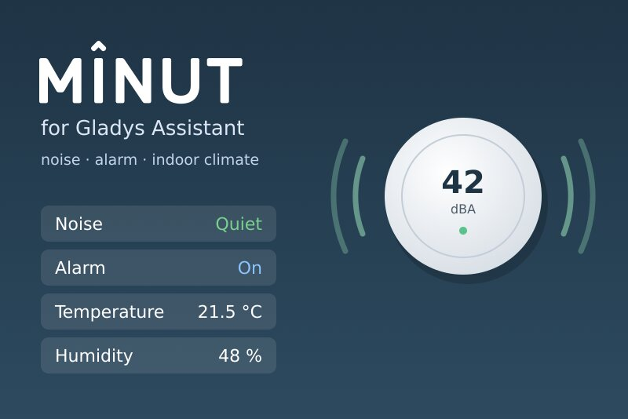
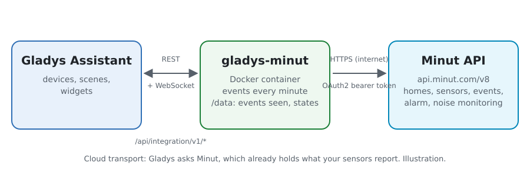
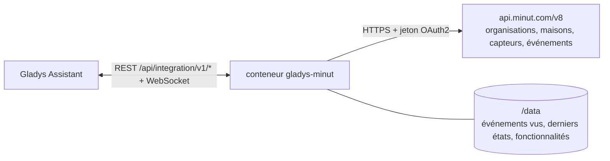
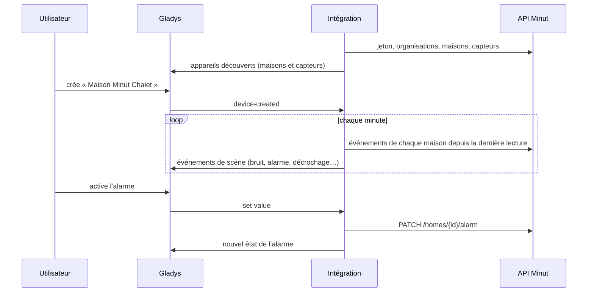
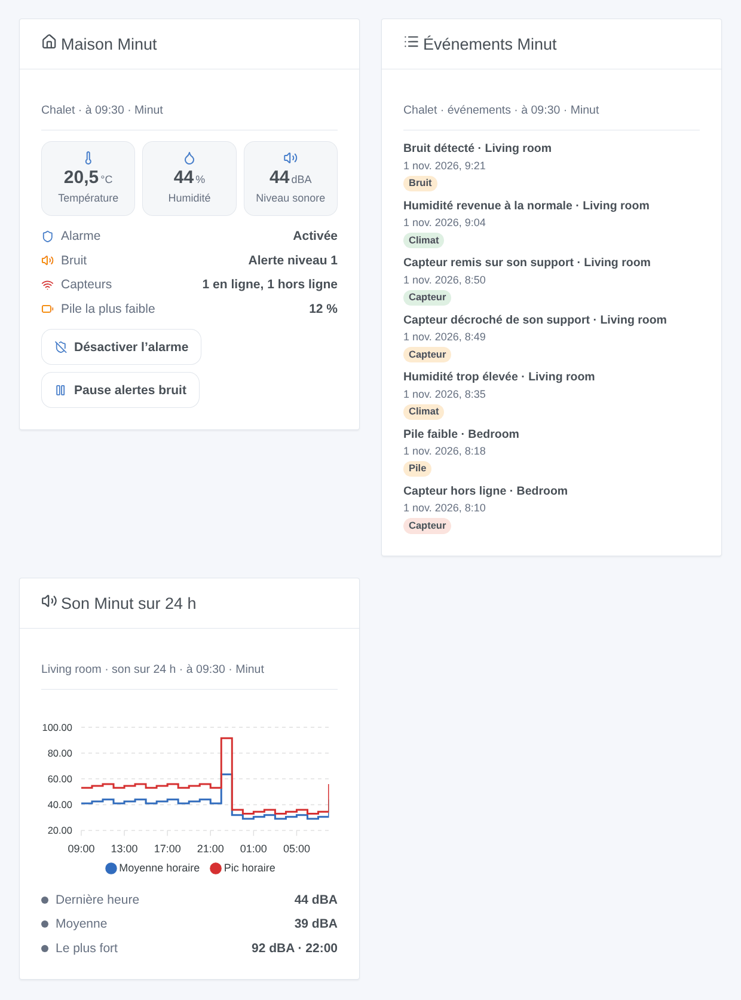

# Gladys Minut

[English](README.md) · **Français** · [Deutsch](README.de.md) · [Español](README.es.md)

[](LICENSE)
[](https://github.com/William-De71/gladys-minut/releases)
[](https://github.com/William-De71/gladys-minut/actions/workflows/release.yml)
[](https://gladysassistant.com)



Intégration externe [Gladys Assistant](https://gladysassistant.com) pour les capteurs de logement **[Minut](https://www.minut.com)** (Minut Point et ses successeurs) : température, humidité, niveau sonore, pile, l’alarme de sécurité et la surveillance du bruit de chaque maison, des scènes sur les événements que Minut signale, et des widgets de tableau de bord. Elle lit l’API officielle de Minut avec un client OAuth2 de votre compte Minut.

> **Avant de commencer** : Minut n’ouvre son API qu’aux comptes de son offre **Enterprise** (sinon, « book a demo » auprès de Minut). Cette intégration a été écrite d’après la référence officielle de l’API et **n’a jamais été testée avec un vrai compte Minut** : vos retours sont les bienvenus.

## Fonctionnalités

- **Un appareil par capteur Minut** : température, humidité, niveau sonore (dBA), pression, pile, et « décroché de son support » sur les capteurs qui le signalent.
- **Un appareil par maison Minut** : l’alarme de sécurité (activée / désactivée, pilotable), son état en clair, les alertes bruit (actives / en pause, pilotables) et l’état de la surveillance du bruit.
- **13 déclencheurs de scène**, **4 actions de scène** et **3 widgets** (ci-dessous).
- Lecture au rythme des capteurs : les événements de chaque maison chaque minute, les maisons toutes les 5 minutes, les capteurs à leur prochaine transmission prévue (5 à 60 minutes), toujours sous la limite de requêtes de l’API.
- Boutons de configuration : connecter et rechercher, diagnostic.
- Quatre langues partout : anglais, français, allemand, espagnol.

## Fonctionnement





L’intégration obtient un jeton avec les identifiants de votre client d’API Minut (`POST /oauth/token`), renouvelé avant son expiration. Elle liste vos organisations (`GET /organizations`), puis leurs maisons et leurs capteurs (`GET /organizations/{id}/homes` et `/devices` : la référence publique ne documente pas de liste à la racine). Les capteurs Minut fonctionnent sur piles et transmettent environ une fois par heure, ou tout de suite quand il se passe quelque chose : les lire plus souvent n’apporte rien et Minut peut bloquer le client. L’intégration lit donc les capteurs à leur prochaine transmission (`next_heartbeat_at` + 2 minutes, entre 5 et 60 minutes), les maisons toutes les 5 minutes, et les événements de chaque maison chaque minute (`GET /homes/{id}/events`) ; un événement avance la lecture suivante. Toutes les requêtes passent par une file : 250 ms d’écart, 100 par minute au plus (Minut en autorise 120) ; un 429 met tout en pause, de 1 à 30 minutes.



### Transport

Cloud uniquement (`"transports": ["cloud"]`) : le catalogue affiche le badge cloud. L’intégration contacte `api.minut.com` en HTTPS ; Minut détient déjà ce que vos capteurs transmettent. Minut n’a pas d’API locale, il n’y a donc pas de bouton « Préférer la connexion locale ». Les webhooks demanderaient une adresse HTTPS publique : la version 0.1.0 lit les événements à la place.

## Appareils et fonctionnalités

| Appareil      | Fonctionnalité          | Catégorie / type     | Remarque                                                      |
| ------------- | ----------------------- | -------------------- | ------------------------------------------------------------- |
| Capteur Minut | Température             | `temperature-sensor` | °C                                                            |
| Capteur Minut | Humidité                | `humidity-sensor`    | %                                                             |
| Capteur Minut | Niveau sonore           | `noise-sensor`       | dB (pondéré A par Minut), nombre entier                       |
| Capteur Minut | Pression atmosphérique  | `pressure-sensor`    | hPa, quand le capteur la donne                                |
| Capteur Minut | Pile                    | `battery`            | %, quand Minut la donne                                       |
| Capteur Minut | Décroché de son support | `tamper/binary`      | 1 hors de son support, capteurs récents seulement             |
| Maison Minut  | Alarme                  | `switch/binary`      | pilotable : activée / désactivée                              |
| Maison Minut  | État de l’alarme        | `text/text`          | activée, désactivée, en cours d’activation, délai, déclenchée |
| Maison Minut  | Surveillance du bruit   | `switch/binary`      | pilotable : active / en pause pour la durée réglée            |
| Maison Minut  | Perturbation sonore     | `text/text`          | calme, alerte niveau 1 à 4, en pause, désactivée              |

`should_poll: false` (l’intégration a son propre minuteur). Une fonctionnalité est proposée dès que Minut a donné sa valeur et ne disparaît jamais ; une valeur que Minut n’a pas donnée n’est pas publiée. Les identifiants externes viennent des identifiants Minut. Il n’y a pas de fonctionnalité « en ligne » (Gladys n’a pas de catégorie pour cela) : le déclencheur **capteur hors ligne ou de retour** et le widget de la maison s’en chargent. Le mouvement ne figure pas dans les événements de maison de l’API et n’est pas géré.

## Déclencheurs, actions et widgets



**Déclencheurs** (filtres : maison, capteur, état ; les variables donnent les noms, le type d’événement Minut, son heure et son titre)

- **Perturbation sonore** : un bruit au-dessus du seuil de la surveillance du bruit (`noise_detected`), ou sa fin (`noise_quieted`), avec le niveau sonore et le seuil.
- **Alarme incendie ou CO entendue** : un capteur reconnaît le son d’un détecteur (`alarm_heard`).
- **Alarme de sécurité** : déclenchée après un mouvement, réduite au silence, ou coupée sur un capteur.
- **Alarme activée ou désactivée** hors de Gladys (appli Minut, programmation) : jamais après une commande envoyée par Gladys.
- **Capteur décroché** : décroché, remis en place, ou boîtier ouvert.
- **Capteur hors ligne ou de retour**, **pile faible** (faible, vide).
- **Alerte de température** (trop élevée, trop basse, revenue à la normale, risque de gel), **alerte d’humidité** (trop élevée, trop basse, revenue à la normale) sur les seuils réglés dans Minut, **risque de moisissure** (détecté, terminé).
- **Bouton du capteur pressé**, **tabagisme détecté**, **affluence détectée**.

**Actions** : activer ou désactiver l’alarme ; faire taire l’alarme ; suspendre ou reprendre les alertes bruit (pour un nombre de minutes) ; lire l’état d’une maison (alarme, bruit, capteurs en ligne, température et humidité moyennes, son le plus fort, pile la plus faible, et une phrase `summary`). Aucune ne déclenche de déclencheur.

**Widgets** : **Maison Minut** (alarme, bruit, capteurs, pile la plus faible, température, humidité, son, avec les boutons d’alarme et de bruit), **Événements Minut** (les derniers événements d’une maison) et **Son Minut sur 24 h** (moyenne et pic horaires d’un capteur).

**Exemples**

- Quand **une perturbation sonore commence** dans la location → un message à l’hôte et les lumières de l’entrée qui clignotent ; quand elle **se termine** → une confirmation.
- Quand **une alarme incendie ou CO est entendue** → toutes les lumières allumées et une notification, même à distance.
- Quand **la maison se vide** (présence Gladys) → **activer l’alarme Minut** ; au retour de quelqu’un → la désactiver.

## Prérequis

- Gladys Assistant **5.3.0** ou plus récent (mots-clés du catalogue). Les instances plus anciennes ne peuvent pas installer l’intégration.
- Des capteurs Minut installés dans l’appli Minut, sur un compte avec **accès à l’API** (offre Minut **Enterprise**).
- Un client d’API de ce compte : appli web Minut → Settings → [Developer tools](https://web.minut.com/settings/api-clients) (voir [docs/fr.md](docs/fr.md#créer-le-client-dapi)).

## Installation

- **Depuis le store** de Gladys (Intégrations → Intégrations externes), en un clic, une fois indexée.
- **Depuis l’URL du dépôt** : `https://github.com/William-De71/gladys-minut`.
- **Mode développeur** : construisez l’image en local (`docker build -t gladys-minut .`) et installez-la depuis Gladys.

## Configuration

| Champ                             | Défaut      | Rôle                                                                      |
| --------------------------------- | ----------- | ------------------------------------------------------------------------- |
| Identifiant du client             | —           | L’identifiant de votre client d’API Minut.                                |
| Secret du client                  | —           | Son secret (champ secret : jamais réaffiché ni journalisé).               |
| Pause des alertes bruit (minutes) | 60          | Durée de la pause quand vous coupez la surveillance du bruit (5 à 1 440). |
| Langue des textes                 | automatique | Noms des appareils et textes des scènes.                                  |

## Utilisation

1. Saisissez l’identifiant et le secret du client, puis enregistrez.
2. Appuyez sur **Connecter et rechercher** : le client est vérifié et vos maisons et capteurs sont listés.
3. Dans l’onglet **Découverte**, créez les appareils « Maison Minut … » et « Minut … ».
4. Ajoutez les widgets **Maison Minut**, **Événements Minut** et **Son Minut sur 24 h** à un tableau de bord, et créez des scènes avec les déclencheurs ci-dessus.

## Développement

```bash
npm install
npm test                       # node --test, ne touche jamais le réseau
npm run lint && npm run format:check
npx github:GladysAssistant/integration-store . --skip-image-check
scripts/build-cover.sh         # cover.jpg depuis docs/assets/cover.svg
docs/illustrations/render.sh   # docs/assets/widgets.<langue>.png
node .github/scripts/release.mjs next
```

En local, le SDK lit `GLADYS_HOST_API_URL`, `GLADYS_INTEGRATION_TOKEN` et `GLADYS_INTEGRATION_SELECTOR` ; `DEBUG=gladys-integration-sdk` affiche les journaux du SDK et vérifie chaque contenu de widget. Les tests servent des réponses construites d’après la [référence de l’API Minut](https://api.minut.com/latest/docs) et les exemples de ses [guides](https://developer.minut.com) (`test/fixtures/`, `test/helpers/fake-api.js`). Les règles du projet sont dans [CLAUDE.md](CLAUDE.md).

## Processus de release


Chaque fusion sur `main` lance la CI, puis calcule la version à partir des [Conventional Commits](https://www.conventionalcommits.org/fr/) depuis le dernier tag : `feat` → mineure, `fix` / `perf` → correctif, `!` ou `BREAKING CHANGE` → majeure (une mineure sous 1.0.0) ; `docs`, `chore`, `ci`, `test`, `style`, `refactor`, `build` seuls ne publient rien. La section du changelog est générée, le tag poussé, l’image multi-architecture construite, puis `main` reçoit le commit de release, la GitHub Release est créée et un dernier job vérifie l’image publique, le validateur du store et le topic.

- Le titre de la pull request devient le commit de squash, puis la ligne du changelog : écrivez-le en anglais, pour l’utilisateur (`pr-title.yml` le vérifie). Ne modifiez jamais `CHANGELOG.md` à la main.
- 1.0.0 est une décision : Actions → Release → Run workflow avec `release-as: 1.0.0`. `dry-run` affiche la version et les notes sans rien publier.
- **Branche protégée** : la release pousse son commit sur `main` avec `GITHUB_TOKEN`. Avec un ruleset qui exige des pull requests ou des status checks sur `main`, ajoutez GitHub Actions à sa liste de contournement (ou poussez par une GitHub App), sinon le job de publication échoue avec des instructions.
- Après la première release, rendez public le package `ghcr.io` (Package settings → Change visibility), sinon Gladys ne peut pas le télécharger.

## Dépannage

Voir [docs/fr.md](docs/fr.md#dépannage). Signalez les problèmes avec les versions de Gladys et de l’intégration, votre offre Minut, et les lignes du bouton **Diagnostic**.

## Contribuer

Issues et pull requests bienvenues. Lancez `npm run format:check && npm run lint && npm test` avant d’ouvrir une pull request, et ne changez aucun identifiant externe ni aucune clé stockée (voir [CLAUDE.md](CLAUDE.md)).

## Sécurité

Voir [SECURITY.md](SECURITY.md) : signalez les failles en privé. Le secret du client est un champ `secret` de Gladys, envoyé seulement à `api.minut.com` en HTTPS (authentification Basic de la demande de jeton), jamais écrit dans les journaux ni dans un message d’erreur ; le jeton d’accès reste en mémoire. L’intégration tourne avec un utilisateur non root, dans un conteneur en lecture seule.

## Captures à venir

Les images ci-dessus sont des illustrations, pas des captures d’écran. Les vraies captures iront dans `docs/assets/screenshots/` (PNG, 1280 × 800) : `configuration.png`, `discovery.png`, `device.png`, `scene.png`.

## Licence

[Licence Apache 2.0](LICENSE) — voir aussi [NOTICE](NOTICE). Minut et le logo Minut sont des marques de leur propriétaire ; cette intégration communautaire n’est ni affiliée à Minut, ni approuvée ou parrainée par Minut. Merci à la documentation et au SDK de Gladys, et à Minut pour la documentation publique de son API.
