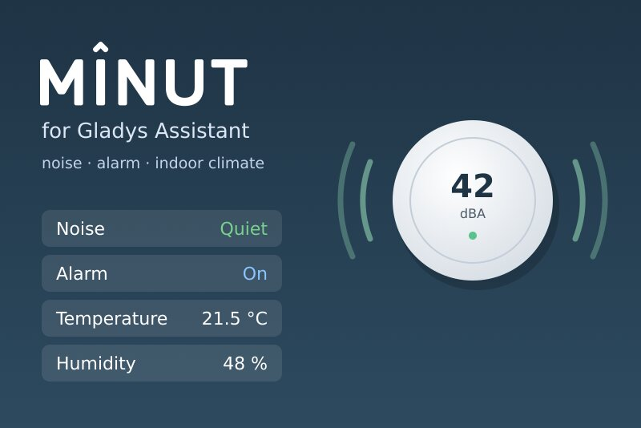
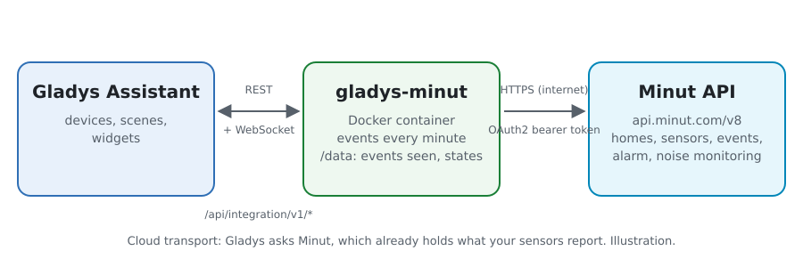
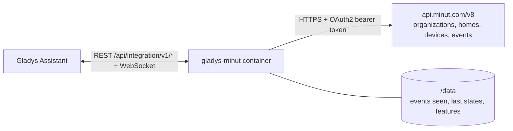
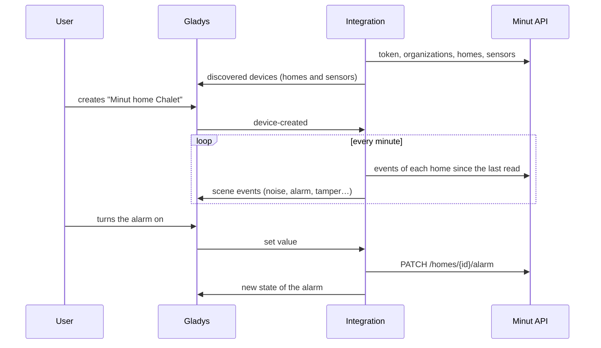
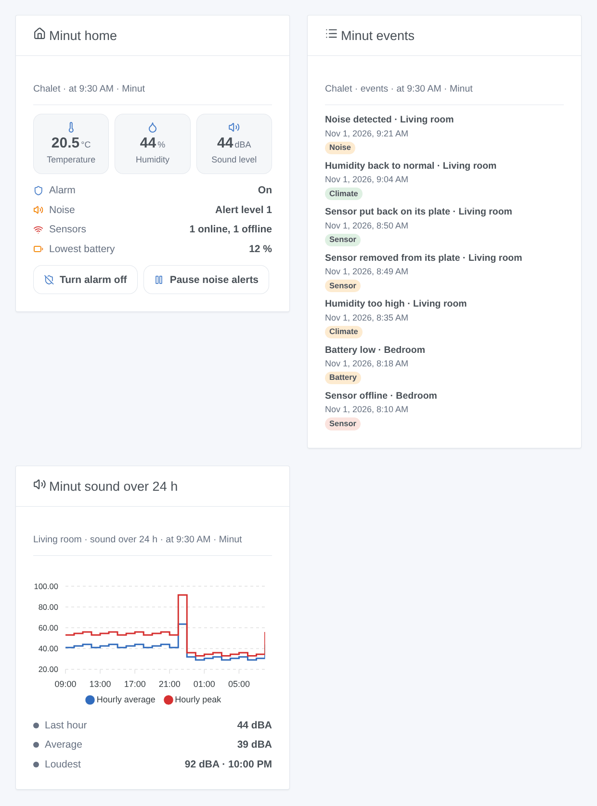

# Gladys Minut

**English** · [Français](README.fr.md) · [Deutsch](README.de.md) · [Español](README.es.md)

[](LICENSE)
[](https://github.com/William-De71/gladys-minut/releases)
[](https://github.com/William-De71/gladys-minut/actions/workflows/release.yml)
[](https://gladysassistant.com)



[Gladys Assistant](https://gladysassistant.com) external integration for the **[Minut](https://www.minut.com)** home sensors (Minut Point and its successors): temperature, humidity, sound level, battery, the security alarm and the noise monitoring of each home, scenes on the events Minut reports, and dashboard widgets. It reads the official Minut API with an OAuth2 client of your Minut account.

> **Before you start**: Minut opens its API only to accounts on its **Enterprise** plan (otherwise "book a demo" with Minut). This integration was written from the official API reference and **has never been tested with a real Minut account**: feedback is welcome.

## Features

- **One device per Minut sensor**: temperature, humidity, sound level (dBA), pressure, battery, and "removed from its plate" on the sensors that report it.
- **One device per Minut home**: the security alarm (on / off, writable), its state in words, the noise alerts (watching / paused, writable) and the state of the noise monitoring.
- **13 scene triggers**, **4 scene actions** and **3 dashboard widgets** (below).
- Reads at the pace of the sensors: the events of each home every minute, the homes every 5 minutes, the sensors at their next expected report (5 to 60 minutes), always under the rate limit of the API.
- Configuration buttons: connect and search, diagnostic.
- Four languages everywhere: English, French, German, Spanish.

## How it works





The integration gets a token with the client credentials of your Minut API client (`POST /oauth/token`), renewed before it expires. It lists your organizations (`GET /organizations`), then their homes and sensors (`GET /organizations/{id}/homes` and `/devices`: the public reference documents no list at the root). Minut sensors run on batteries and report about once an hour, or at once when something happens: reading them more often brings nothing and Minut may block the client. So the integration reads the sensors when their next report is due (`next_heartbeat_at` + 2 minutes, between 5 and 60 minutes), the homes every 5 minutes, and the events of each home every minute (`GET /homes/{id}/events`); an event brings the next read forward. Every request goes through one queue: 250 ms apart, 100 a minute at most (Minut allows 120); a 429 pauses everything, from 1 to 30 minutes.



### Transport

Cloud only (`"transports": ["cloud"]`): the catalog shows the cloud badge. The integration contacts `api.minut.com` over HTTPS; Minut already holds what your sensors report. Minut has no local API, so there is no "prefer the local connection" button. Webhooks would need a public HTTPS address: version 0.1.0 reads the events instead.

## Devices and features

| Device       | Feature                | Category / type      | Note                                               |
| ------------ | ---------------------- | -------------------- | -------------------------------------------------- |
| Minut sensor | Temperature            | `temperature-sensor` | °C                                                 |
| Minut sensor | Humidity               | `humidity-sensor`    | %                                                  |
| Minut sensor | Sound level            | `noise-sensor`       | dB (A-weighted by Minut), whole number             |
| Minut sensor | Atmospheric pressure   | `pressure-sensor`    | hPa, when the sensor gives it                      |
| Minut sensor | Battery                | `battery`            | %, when Minut gives it                             |
| Minut sensor | Removed from its plate | `tamper/binary`      | 1 when off its mounting plate, recent sensors only |
| Minut home   | Alarm                  | `switch/binary`      | writable: on / off                                 |
| Minut home   | Alarm status           | `text/text`          | on, off, turning on, grace period, triggered       |
| Minut home   | Noise monitoring       | `switch/binary`      | writable: watching / paused for the set length     |
| Minut home   | Noise disturbance      | `text/text`          | quiet, alert level 1 to 4, paused, off             |

`should_poll: false` (the integration has its own timer). A feature is offered once Minut gave its value and never goes away; a value Minut did not give is not published. External ids come from the Minut ids. There is no "online" feature (Gladys has no category for it): the **sensor offline or back** trigger and the home widget cover it. Motion is not in the home events of the API and is left out.

## Scene triggers, actions and widgets



**Triggers** (filters: home, sensor, state; variables include the names, the Minut event type, its time and title)

- **Noise disturbance**: noise above the threshold of the noise monitoring (`noise_detected`), or its end (`noise_quieted`), with the sound level and threshold.
- **Smoke or CO alarm heard**: a sensor recognizes the sound of an alarm (`alarm_heard`).
- **Security alarm**: triggered after motion, silenced, or muted on a sensor.
- **Alarm turned on or off** outside Gladys (Minut app, schedule): never after a command sent by Gladys.
- **Sensor taken off its plate**: removed, put back, or casing opened.
- **Sensor offline or back**, **battery low** (low, empty).
- **Temperature alert** (high, low, back to normal, almost freezing), **humidity alert** (high, low, back to normal) on the thresholds set in Minut, **risk of mould** (detected, over).
- **Sensor button pressed**, **smoking detected**, **crowd detected**.

**Actions**: turn the alarm on or off; silence the alarm; pause or resume the noise alerts (for a number of minutes); read the status of a home (alarm, noise, sensors online, average temperature and humidity, loudest sound, lowest battery, and a `summary` sentence). None of them fires a trigger.

**Widgets**: **Minut home** (alarm, noise, sensors, lowest battery, temperature, humidity, sound, with the alarm and noise buttons), **Minut events** (the last events of a home) and **Minut sound over 24 h** (hourly average and peak of a sensor).

**Examples**

- When **a noise disturbance starts** in the rental → a message to the host and the hall lights blinking; when it **ends** → a confirmation.
- When **a smoke or CO alarm is heard** → every light on and a notification, even away from home.
- When **the house becomes empty** (Gladys presence) → **turn the Minut alarm on**; when someone comes back → off.

## Requirements

- Gladys Assistant **5.3.0** or later (catalog keywords). Older instances cannot install the integration.
- Minut sensors set up in the Minut app, on an account with **API access** (Minut **Enterprise** plan).
- An API client of that account: Minut web app → Settings → [Developer tools](https://web.minut.com/settings/api-clients) (see [docs/en.md](docs/en.md#create-the-api-client)).

## Installation

- **From the store** of Gladys (Integrations → External integrations), in one click, once indexed.
- **From the repository URL**: `https://github.com/William-De71/gladys-minut`.
- **Developer mode**: build the image locally (`docker build -t gladys-minut .`) and install it from Gladys.

## Configuration

| Field                        | Default   | Role                                                              |
| ---------------------------- | --------- | ----------------------------------------------------------------- |
| Client id                    | —         | The id of your Minut API client.                                  |
| Client secret                | —         | Its secret (a secret field: never shown again nor logged).        |
| Noise alerts pause (minutes) | 60        | How long turning the noise monitoring off pauses it (5 to 1,440). |
| Language of the texts        | automatic | Device names and scene texts.                                     |

## Usage

1. Enter the client id and secret, then save.
2. Press **Connect and search**: it checks the client and lists your homes and sensors.
3. In the **Discover** tab, create the "Minut home …" and "Minut …" devices.
4. Add the **Minut home**, **Minut events** and **Minut sound over 24 h** widgets to a dashboard, and build scenes with the triggers above.

## Development

```bash
npm install
npm test                       # node --test, never touches the network
npm run lint && npm run format:check
npx github:GladysAssistant/integration-store . --skip-image-check
scripts/build-cover.sh         # cover.jpg from docs/assets/cover.svg
docs/illustrations/render.sh   # docs/assets/widgets.<lang>.png
node .github/scripts/release.mjs next
```

Locally, the SDK reads `GLADYS_HOST_API_URL`, `GLADYS_INTEGRATION_TOKEN` and `GLADYS_INTEGRATION_SELECTOR`; `DEBUG=gladys-integration-sdk` shows the SDK logs and checks every widget content. The tests serve answers built after the [Minut API reference](https://api.minut.com/latest/docs) and the examples of its [guides](https://developer.minut.com) (`test/fixtures/`, `test/helpers/fake-api.js`). The rules of the project are in [CLAUDE.md](CLAUDE.md).

## Release process


Every merge on `main` runs the CI, then computes the version from the [Conventional Commits](https://www.conventionalcommits.org/) since the last tag: `feat` → minor, `fix` / `perf` → patch, `!` or `BREAKING CHANGE` → major (a minor below 1.0.0); `docs`, `chore`, `ci`, `test`, `style`, `refactor`, `build` alone publish nothing. The changelog section is generated, the tag pushed, the multi-architecture image built, then `main` receives the release commit, the GitHub Release is created and a last job checks the public image, the store validator and the topic.

- The pull request title becomes the squash commit, then the changelog line: write it in English, for the user (`pr-title.yml` checks it). Never edit `CHANGELOG.md` by hand.
- 1.0.0 is a decision: Actions → Release → Run workflow with `release-as: 1.0.0`. `dry-run` shows the version and the notes without publishing.
- **Protected branch**: the release pushes its commit to `main` with `GITHUB_TOKEN`. With a ruleset requiring pull requests or status checks on `main`, add GitHub Actions to its bypass list (or push through a GitHub App), otherwise the publish job fails with instructions.
- After the first release, make the `ghcr.io` package public (Package settings → Change visibility), or Gladys cannot pull it.

## Troubleshooting

See [docs/en.md](docs/en.md#troubleshooting). Report issues with the versions of Gladys and of the integration, your Minut plan, and the lines of the **Diagnostic** button.

## Contributing

Issues and pull requests are welcome. Run `npm run format:check && npm run lint && npm test` before opening a pull request, and keep every external id and stored key unchanged (see [CLAUDE.md](CLAUDE.md)).

## Security

See [SECURITY.md](SECURITY.md): report vulnerabilities privately. The client secret is a `secret` field of Gladys, sent only to `api.minut.com` over HTTPS (Basic authentication of the token request), never written to the logs nor to an error message; the access token stays in memory. The integration runs as a non-root user, in a read-only container.

## Screenshots to come

The images above are illustrations, not screenshots. Real screenshots will go in `docs/assets/screenshots/` (PNG, 1280 × 800): `configuration.png`, `discovery.png`, `device.png`, `scene.png`.

## License

[Apache License 2.0](LICENSE) — see also [NOTICE](NOTICE). Minut and the Minut logo are trademarks of their owner; this community integration is not affiliated with, endorsed or sponsored by Minut. Thanks to the Gladys documentation and SDK, and to Minut for its public API documentation.
