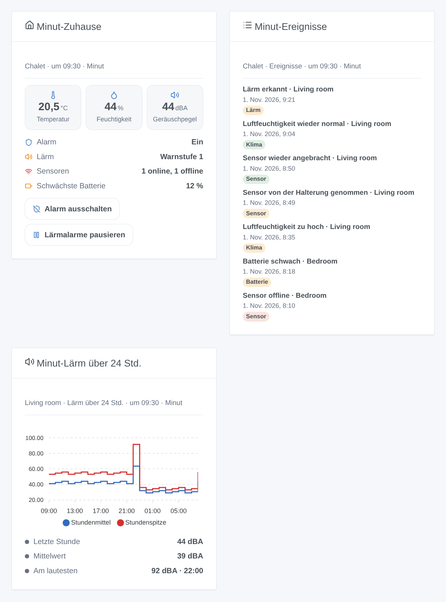

# Minut

## Überblick

[Minut](https://www.minut.com) stellt batteriebetriebene Wohnungssensoren her, die in Ferienwohnungen, Wohnungen und Häusern eingesetzt werden: Sie überwachen den **Lärm**, ohne Ton aufzunehmen, die **Temperatur**, die **Luftfeuchtigkeit**, den **Luftdruck**, erkennen den Ton eines **Rauch- oder CO-Melders** und dienen als **Sicherheitsalarm** mit Bewegungserkennung. Jeder Sensor meldet sich etwa einmal pro Stunde bei der Minut-Cloud, und sofort, wenn etwas passiert.

Diese Integration bringt sie über die [offizielle Minut-API](https://developer.minut.com) in Gladys: ein Gerät pro Sensor und eines pro Zuhause, Alarm und Lärmalarme aus Gladys steuerbar, Szenenauslöser auf den Ereignissen, die Minut meldet, Szenenaktionen und drei Dashboard-Widgets.

**Wichtig**: Minut öffnet seine API nur für Konten mit dem **Enterprise**-Tarif; sonst bietet die Website von Minut „Book a demo“ an. Die Integration wurde nach der offiziellen API-Referenz geschrieben und nie mit einem echten Minut-Konto getestet: Sag uns, was du beobachtest.

## Voraussetzungen

- Gladys Assistant **5.3.0** oder neuer (Katalog-Schlüsselwörter). Ältere Instanzen können die Integration nicht installieren.
- Minut-Sensoren, eingerichtet in der Minut-App, auf einem Konto mit API-Zugang (Minut-Tarif Enterprise).
- Ein Minut-API-Client (unten).

### API-Client anlegen

1. Melde dich in der [Minut-Web-App](https://web.minut.com) mit dem Konto deiner Zuhause an.
2. Öffne **Settings**, dann **Developer tools** ([web.minut.com/settings/api-clients](https://web.minut.com/settings/api-clients)), und leg einen API-Client an. Eine Weiterleitungsadresse ist nicht nötig: Die Integration nutzt den Typ `client_credentials`, für deine eigenen Daten.
3. Kopier seine **Client-ID** und sein **Client-Secret**.

Fehlt die Seite Developer tools oder bekommt der Client keine Organisation, ist der API-Zugang im Konto nicht aktiviert: Wende dich an Minut.

## Konfiguration

| Feld                           | Was eintragen                                                                                                     |
| ------------------------------ | ----------------------------------------------------------------------------------------------------------------- |
| Client-ID                      | Die ID deines Minut-API-Clients.                                                                                  |
| Client-Secret                  | Sein Secret. Als Geheimnis gespeichert, nie wieder angezeigt oder geloggt.                                        |
| Pause der Lärmalarme (Minuten) | Wie lange das Ausschalten der Lärmüberwachung sie pausiert (ein Minut-„Snooze“), 5 bis 1440 Minuten. Standard 60. |
| Sprache der Texte              | Gerätenamen und Texte für Szenen. Automatisch: die Sprache des zuletzt angezeigten Widgets.                       |

Zwei Tasten ergänzen die Seite: **Verbinden und suchen** (prüft den Client, listet deine Zuhause und Sensoren und bietet sie im Tab Entdecken an) und **Diagnose** (der Zustand der Integration in ihren Logs, ohne das Secret).

## Verwendung

### Geräte

Öffne den Tab **Entdecken** der Integration und leg die Geräte an:

- **Minut-Zuhause …**, eines pro Zuhause: **Alarm** (ein Schalter: ein oder aus), **Alarmstatus** (ein, aus, wird eingeschaltet, Karenzzeit, Alarm ausgelöst), **Lärmüberwachung** (ein Schalter: Lärmalarme aktiv oder für die eingestellte Dauer pausiert) und **Lärmstörung** (ruhig, Warnstufe 1 bis 4, pausiert, aus). Der Alarm erscheint, wenn Minut seinen Zustand liefert, die Lärmüberwachung, wenn sie in Minut eingeschaltet ist.
- **Minut …**, eines pro Sensor, benannt wie in der Minut-App: **Temperatur** (°C), **Luftfeuchtigkeit** (%), **Geräuschpegel** (dB, von Minut A-bewertet), **Luftdruck** (hPa), **Batterie** (%) und **Von der Halterung genommen** (1, wenn der Sensor nicht auf seiner Halterung ist; nur neuere Sensoren), jeweils sobald Minut den Wert geliefert hat.

Eine angebotene Funktion verschwindet nie; ein Wert, den Minut nicht geliefert hat, behält den letzten. Es gibt keine Funktion „online“: Nutz den Auslöser **Sensor offline oder zurück**. Bewegung gehört nicht zu den Zuhause-Ereignissen der API und ist nicht verfügbar.

Minut-Sensoren melden sich etwa einmal pro Stunde: Die Integration liest sie bei ihrer nächsten erwarteten Meldung (zwischen 5 und 60 Minuten), die Zuhause alle 5 Minuten und die Ereignisse jede Minute, immer unter dem Anfragelimit der API (höchstens 100 Anfragen pro Minute, Minut erlaubt 120).

### Dashboard-Widgets

- **Minut-Zuhause**: der Alarm, die Lärmüberwachung, die Sensoren online und offline, die schwächste Batterie, dann die mittlere Temperatur und Luftfeuchtigkeit und der lauteste Geräuschpegel; Tasten, um den Alarm ein- oder auszuschalten (mit Bestätigung), ihn stummzuschalten, wenn er läutet, und die Lärmalarme zu pausieren oder fortzusetzen.
- **Minut-Ereignisse**: die letzten 8 Ereignisse eines Zuhauses (Lärm, Alarme, Sensoren, Klima, Batterie), das neueste zuerst.
- **Minut-Lärm über 24 Std.**: Stundenmittel und -spitze des Geräuschpegels eines Sensors, mit der letzten Stunde, dem Mittelwert und der lautesten Stunde.

Die ersten beiden haben eine Einstellung **Minut-Zuhause**, das dritte eine Einstellung **Sensor** (standardmäßig der erste).

### Szenen

Auslöser (Filter: Zuhause, Sensor und Zustand; Variablen: `home_name`, `device_name`, `state`, `event_type`, `event_time`, `time`, `title` und die IDs in Gladys):

- **Minut: Lärmstörung**: `started` (Lärm über der Schwelle der Lärmüberwachung) oder `ended`. Dazu `sound_level`, `sound_threshold`, `noise_count`.
- **Minut: Rauch- oder CO-Alarm gehört**: Ein Sensor erkennt den Ton eines Melders.
- **Minut: Sicherheitsalarm**: `triggered` (nach einer Bewegung, nach Ablauf der Karenzzeit), `silenced`, `muted` am Sensor.
- **Minut: Alarm ein- oder ausgeschaltet**: `on` oder `off`, außerhalb von Gladys geändert (Minut-App, Zeitplan). Ein Befehl von Gladys löst ihn nie aus.
- **Minut: Sensor abgenommen**: `removed`, `mounted`, `moved` (ältere Sensoren), `casing` (Gehäuse geöffnet).
- **Minut: Sensor offline oder zurück**: `offline`, `online`.
- **Minut: Batterie schwach**: `low` (etwa zwei Wochen übrig), `empty`.
- **Minut: Temperaturwarnung**: `high`, `low`, `normal`, `freezing` — auf den in Minut eingestellten Schwellen.
- **Minut: Feuchtigkeitswarnung**: `high`, `low`, `normal`.
- **Minut: Schimmelgefahr**: `detected`, `cleared`.
- **Minut: Sensortaste gedrückt**, **Minut: Rauchen erkannt**, **Minut: Menschenmenge erkannt**.

Ereignisse kommen nach ein bis zwei Minuten in Gladys an. Nur Ereignisse nach dem ersten Start zählen, jedes nur einmal.

Aktionen:

- **Minut: Alarm ein- oder ausschalten** (Zuhause, ein / aus).
- **Minut: Alarm stummschalten** (Zuhause).
- **Minut: Lärmalarme pausieren oder fortsetzen** (Zuhause, pausieren / fortsetzen, Minuten).
- **Minut: Status eines Zuhauses lesen**: Alarm, Lärm, Sensoren online und offline, mittlere Temperatur und Luftfeuchtigkeit, lautester Geräuschpegel, schwächste Batterie und ein fertiger Satz `summary`.

Keine davon löst einen Auslöser aus. Beispiele:

- Wenn **eine Lärmstörung beginnt** → `Lärm in {{triggerEvent.data.home_name}}: {{triggerEvent.data.sound_level}} dBA` an den Gastgeber senden; wenn sie **endet** → eine kurze Bestätigung.
- Wenn **ein Rauch- oder CO-Alarm gehört wird** → alle Lichter an und eine Benachrichtigung.
- Wenn **das Haus leer wird** → **den Minut-Alarm einschalten**; wenn jemand zurückkommt → aus.

### Transport

Cloud (`"transports": ["cloud"]`): Die Integration kontaktiert `api.minut.com` über HTTPS mit einem OAuth2-Token deines Clients; Minut hat bereits, was deine Sensoren melden. Webhooks werden nicht genutzt (sie brauchen eine öffentliche HTTPS-Adresse): Die Integration liest stattdessen die Ereignisse. Die letzten Zustände, die Funktionen jedes Geräts und die bereits ausgelösten Ereignisse werden im Volume `/data` der Integration gespeichert: Ein Neustart löst nichts doppelt aus.

## Fehlerbehebung

- **Minut hat die Client-ID oder das Secret abgelehnt**: Kopier sie erneut von der Seite Developer tools und speichere die Konfiguration.
- **Minut liefert keine Organisation für diesen Client** oder **Minut hat den Zugriff verweigert**: Der API-Zugang ist im Konto nicht aktiviert (Enterprise-Tarif); wende dich an Minut.
- **Minut bittet um weniger Anfragen**: Die Integration pausiert von selbst und macht dann weiter; nichts zu tun.
- **Der Alarm kann nicht eingeschaltet werden: Die Bewegungserkennung ist aus**: Bewegung und Anwesenheit sind für die Organisation in Minut ausgeschaltet.
- **Die Lärmüberwachung ist für dieses Zuhause nicht eingeschaltet**: Schalt sie zuerst in der Minut-App ein.
- **Werte ändern sich nur etwa einmal pro Stunde**: Das ist der Takt der Sensoren; Ereignisse kommen sofort.
- **Immer noch Probleme**: Drück **Diagnose** und öffne ein Issue auf [GitHub](https://github.com/William-De71/gladys-minut/issues) mit den Versionen von Gladys und der Integration, deinem Minut-Tarif und den Zeilen „Minut diagnostic“ aus den Logs (im Entwicklermodus `DEBUG=gladys-integration-sdk` hinzufügen).

Minut ist eine Marke ihres Inhabers. Diese Community-Integration ist nicht mit Minut verbunden.
