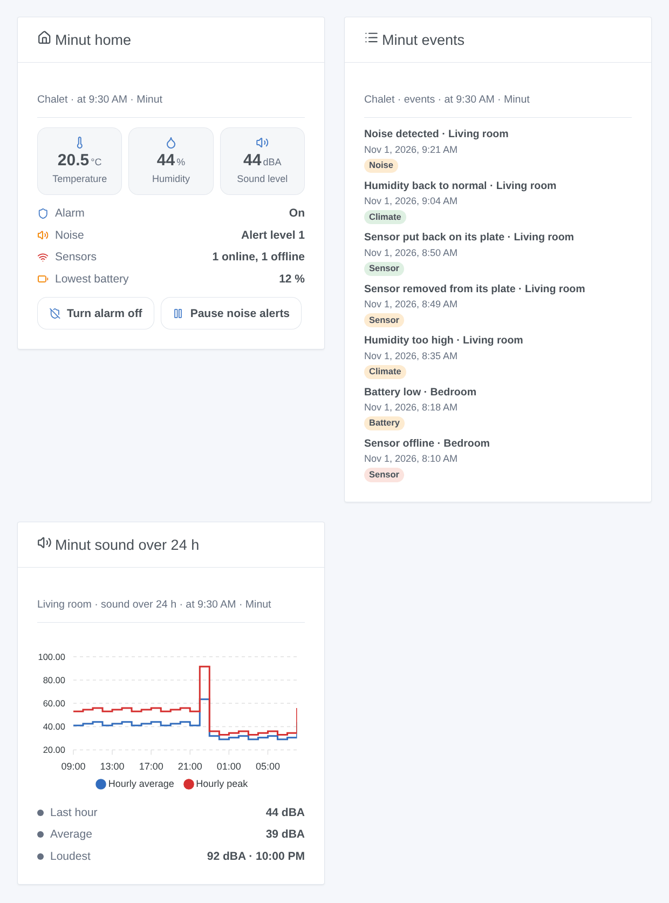

# Minut

## Overview

[Minut](https://www.minut.com) makes battery-powered home sensors used in holiday rentals, flats and houses: they watch the **noise** without recording any sound, the **temperature**, the **humidity**, the **pressure**, recognize the sound of a **smoke or CO alarm**, and act as a **security alarm** with motion detection. Each sensor reports to the Minut cloud about once an hour, and at once when something happens.

This integration brings them into Gladys through the official [Minut API](https://developer.minut.com): one device per sensor and one per home, the alarm and the noise alerts controlled from Gladys, scene triggers on the events Minut reports, scene actions and three dashboard widgets.

**Important**: Minut opens its API only to accounts on its **Enterprise** plan; otherwise the Minut website offers to "book a demo". The integration was written from the official API reference and has never been tested with a real Minut account: please report what you see.

## Prerequisites

- Gladys Assistant **5.3.0** or later (catalog keywords). Older instances cannot install the integration.
- Minut sensors set up in the Minut app, on an account with API access (Minut Enterprise plan).
- A Minut API client (below).

### Create the API client

1. Sign in to the [Minut web app](https://web.minut.com) with the account of your homes.
2. Open **Settings**, then **Developer tools** ([web.minut.com/settings/api-clients](https://web.minut.com/settings/api-clients)), and create an API client. No redirect address is needed: the integration uses the `client_credentials` grant, for your own data.
3. Copy its **client id** and **client secret**.

If the Developer tools page is missing, or if the client gets no organization, API access is not enabled on the account: contact Minut.

## Configuration

| Field                        | What to enter                                                                                                   |
| ---------------------------- | --------------------------------------------------------------------------------------------------------------- |
| Client id                    | The id of your Minut API client.                                                                                |
| Client secret                | Its secret. Stored as a secret, never shown again nor logged.                                                   |
| Noise alerts pause (minutes) | How long turning the noise monitoring off pauses it (a Minut "snooze"), from 5 to 1,440 minutes. 60 by default. |
| Language of the texts        | Device names and the texts given to scenes. Automatic: the language of the last widget shown.                   |

Two buttons complete the screen: **Connect and search** (checks the client, lists your homes and sensors and offers them in the Discover tab) and **Diagnostic** (the state of the integration in its logs, without the secret).

## Usage

### Devices

Open the **Discover** tab of the integration and create the devices:

- **Minut home …**, one per home: **Alarm** (a switch: on or off), **Alarm status** (on, off, turning on, grace period, alarm triggered), **Noise monitoring** (a switch: noise alerts watching, or paused for the length set in the configuration) and **Noise disturbance** (quiet, alert level 1 to 4, paused, off). The alarm appears when Minut gives its state, the noise monitoring when it is on in Minut.
- **Minut …**, one per sensor, named as in the Minut app: **Temperature** (°C), **Humidity** (%), **Sound level** (dB, A-weighted by Minut), **Atmospheric pressure** (hPa), **Battery** (%) and **Removed from its plate** (1 when the sensor is off its mounting plate; recent sensors only), each one once Minut gave its value.

A feature, once offered, never goes away; a value Minut did not give keeps its last one. There is no "online" feature: use the **sensor offline or back** trigger. Motion is not part of the home events of the API and is not available.

Minut sensors report about once an hour: the integration reads them when their next report is due (between 5 and 60 minutes), the homes every 5 minutes and the events every minute, always under the rate limit of the API (100 requests a minute at most, Minut allows 120).

### Dashboard widgets

- **Minut home**: the alarm, the noise monitoring, the sensors online and offline, the lowest battery, then the average temperature and humidity and the loudest sound level; buttons to turn the alarm on or off (with a confirmation), to silence it while it rings, and to pause or resume the noise alerts.
- **Minut events**: the last 8 events of a home (noise, alarms, sensors, climate, battery), newest first.
- **Minut sound over 24 h**: the hourly average and peak of the sound level of a sensor, with the last hour, the average and the loudest hour.

The first two have a setting **Minut home**, the third a setting **Sensor** (the first one by default).

### Scenes

Triggers (filters: home, sensor and state; variables: `home_name`, `device_name`, `state`, `event_type`, `event_time`, `time`, `title`, and the ids in Gladys):

- **Minut: noise disturbance**: `started` (noise above the threshold of the noise monitoring) or `ended`. Also `sound_level`, `sound_threshold`, `noise_count`.
- **Minut: smoke or CO alarm heard**: a sensor recognizes the sound of an alarm.
- **Minut: security alarm**: `triggered` (after motion, once the grace period expired), `silenced`, `muted` on a sensor.
- **Minut: alarm turned on or off**: `on` or `off`, changed outside Gladys (Minut app, schedule). A command of Gladys never fires it.
- **Minut: sensor taken off its plate**: `removed`, `mounted`, `moved` (older sensors), `casing` opened.
- **Minut: sensor offline or back**: `offline`, `online`.
- **Minut: battery low**: `low` (about two weeks left), `empty`.
- **Minut: temperature alert**: `high`, `low`, `normal`, `freezing` — on the thresholds set in Minut.
- **Minut: humidity alert**: `high`, `low`, `normal`.
- **Minut: risk of mould**: `detected`, `cleared`.
- **Minut: sensor button pressed**, **Minut: smoking detected**, **Minut: crowd detected**.

Events reach Gladys within a minute or two. Only the events after the first start count, each one once.

Actions:

- **Minut: turn the alarm on or off** (home, on / off).
- **Minut: silence the alarm** (home).
- **Minut: pause or resume noise alerts** (home, pause / resume, minutes).
- **Minut: read the status of a home**: alarm, noise, sensors online and offline, average temperature and humidity, loudest sound level, lowest battery, and a ready-made `summary` sentence.

None of them fires a trigger. Examples:

- When **a noise disturbance starts** → send `Noise in {{triggerEvent.data.home_name}}: {{triggerEvent.data.sound_level}} dBA` to the host; when it **ends** → a short confirmation.
- When **a smoke or CO alarm is heard** → every light on, and a notification.
- When **the house becomes empty** → **turn the Minut alarm on**; when someone comes back → off.

### Transport

Cloud (`"transports": ["cloud"]`): the integration contacts `api.minut.com` over HTTPS with an OAuth2 token of your client; Minut already holds what your sensors report. Webhooks are not used (they need a public HTTPS address): the integration reads the events instead. The last states, the features of each device and the events already fired are kept in the `/data` volume of the integration, so a restart fires nothing twice.

## Troubleshooting

- **Minut refused the client id or secret**: copy them again from the Developer tools page, then save the configuration.
- **Minut gives no organization for this client**, or **Minut refused access**: API access is not enabled on the account (Enterprise plan); contact Minut.
- **Minut asked to slow down**: the integration pauses by itself, then starts again; nothing to do.
- **The alarm cannot be turned on: motion detection is turned off**: motion and presence are off for the organization in Minut.
- **Noise monitoring is not turned on for this home**: turn it on in the Minut app first.
- **Values change only about once an hour**: that is the pace of the sensors; events arrive at once.
- **Still stuck**: press **Diagnostic**, then open an issue on [GitHub](https://github.com/William-De71/gladys-minut/issues) with the versions of Gladys and of the integration, your Minut plan, and the "Minut diagnostic" lines of the logs (add `DEBUG=gladys-integration-sdk` in developer mode).

Minut is a trademark of its owner. This community integration is not affiliated with Minut.
