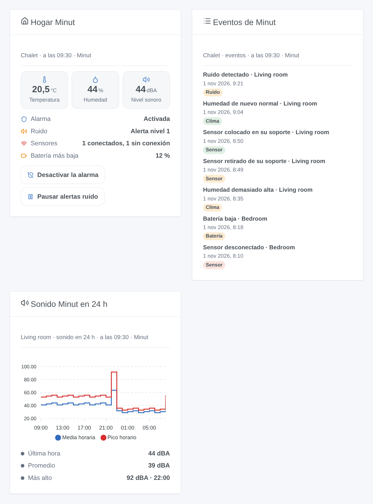

# Minut

## Presentación

[Minut](https://www.minut.com) fabrica sensores de vivienda con pilas, usados en alquileres vacacionales, pisos y casas: vigilan el **ruido** sin grabar ningún sonido, la **temperatura**, la **humedad**, la **presión**, reconocen el sonido de una **alarma de humo o CO** y sirven de **alarma de seguridad** con detección de movimiento. Cada sensor informa a la nube de Minut aproximadamente una vez por hora, y de inmediato cuando ocurre algo.

Esta integración los trae a Gladys a través de la [API oficial de Minut](https://developer.minut.com): un dispositivo por sensor y uno por hogar, la alarma y las alertas de ruido controladas desde Gladys, desencadenantes de escena sobre los eventos que Minut comunica, acciones de escena y tres widgets para el panel.

**Importante**: Minut solo abre su API a las cuentas de su plan **Enterprise**; si no, la web de Minut propone «book a demo». La integración se escribió a partir de la referencia oficial de la API y nunca se ha probado con una cuenta Minut real: cuéntenos lo que observe.

## Requisitos

- Gladys Assistant **5.3.0** o posterior (palabras clave del catálogo). Las instancias más antiguas no pueden instalar la integración.
- Sensores Minut configurados en la app Minut, en una cuenta con acceso a la API (plan Minut Enterprise).
- Un cliente de la API de Minut (abajo).

### Crear el cliente de API

1. Inicie sesión en la [app web de Minut](https://web.minut.com) con la cuenta de sus hogares.
2. Abra **Settings**, luego **Developer tools** ([web.minut.com/settings/api-clients](https://web.minut.com/settings/api-clients)), y cree un cliente de API. No hace falta ninguna dirección de redirección: la integración usa el tipo `client_credentials`, para sus propios datos.
3. Copie su **id de cliente** (client id) y su **secreto** (client secret).

Si la página Developer tools no existe, o si el cliente no obtiene ninguna organización, el acceso a la API no está activado en la cuenta: contacte con Minut.

## Configuración

| Campo                               | Qué introducir                                                                                                          |
| ----------------------------------- | ----------------------------------------------------------------------------------------------------------------------- |
| Id del cliente                      | El id de su cliente de la API de Minut.                                                                                 |
| Secreto del cliente                 | Su secreto. Guardado como secreto, nunca se vuelve a mostrar ni se registra.                                            |
| Pausa de alertas de ruido (minutos) | Cuánto dura la pausa al desactivar la vigilancia del ruido (un «snooze» de Minut), de 5 a 1440 minutos. 60 por defecto. |
| Idioma de los textos                | Nombres de los dispositivos y textos dados a las escenas. Automático: el idioma del último widget mostrado.             |

Dos botones completan la pantalla: **Conectar y buscar** (comprueba el cliente, lista sus hogares y sensores y los ofrece en la pestaña Descubrir) y **Diagnóstico** (el estado de la integración en sus registros, sin el secreto).

## Uso

### Dispositivos

Abra la pestaña **Descubrir** de la integración y cree los dispositivos:

- **Hogar Minut …**, uno por hogar: **Alarma** (un interruptor: activada o desactivada), **Estado de la alarma** (activada, desactivada, activándose, periodo de gracia, alarma disparada), **Vigilancia del ruido** (un interruptor: alertas de ruido activas, o en pausa durante el tiempo fijado en la configuración) y **Molestia por ruido** (tranquilo, alerta nivel 1 a 4, en pausa, desactivada). La alarma aparece cuando Minut da su estado, la vigilancia del ruido cuando está activada en Minut.
- **Minut …**, uno por sensor, con el nombre de la app Minut: **Temperatura** (°C), **Humedad** (%), **Nivel de sonido** (dB, ponderado A por Minut), **Presión atmosférica** (hPa), **Batería** (%) y **Retirado de su soporte** (1 cuando el sensor está fuera de su soporte; solo sensores recientes), cada una en cuanto Minut da su valor.

Una funcionalidad ofrecida nunca desaparece; un valor que Minut no dio conserva el anterior. No hay funcionalidad «conectado»: use el desencadenante **sensor desconectado o de vuelta**. El movimiento no forma parte de los eventos de hogar de la API y no está disponible.

Los sensores Minut informan aproximadamente una vez por hora: la integración los lee en su próximo informe previsto (entre 5 y 60 minutos), los hogares cada 5 minutos y los eventos cada minuto, siempre por debajo del límite de solicitudes de la API (100 solicitudes por minuto como máximo, Minut permite 120).

### Widgets del panel

- **Hogar Minut**: la alarma, la vigilancia del ruido, los sensores conectados y desconectados, la batería más baja, luego la temperatura y la humedad medias y el nivel sonoro más alto; botones para activar o desactivar la alarma (con confirmación), silenciarla cuando suena, y pausar o reanudar las alertas de ruido.
- **Eventos de Minut**: los 8 últimos eventos de un hogar (ruido, alarmas, sensores, clima, batería), del más reciente al más antiguo.
- **Sonido Minut en 24 h**: la media y el pico por hora del nivel sonoro de un sensor, con la última hora, la media y la hora más ruidosa.

Los dos primeros tienen un ajuste **Hogar Minut**, el tercero un ajuste **Sensor** (el primero por defecto).

### Escenas

Desencadenantes (filtros: hogar, sensor y estado; variables: `home_name`, `device_name`, `state`, `event_type`, `event_time`, `time`, `title`, y los identificadores en Gladys):

- **Minut: molestia por ruido**: `started` (ruido por encima del umbral de la vigilancia del ruido) o `ended`. También `sound_level`, `sound_threshold`, `noise_count`.
- **Minut: alarma de humo o CO oída**: un sensor reconoce el sonido de un detector.
- **Minut: alarma de seguridad**: `triggered` (tras un movimiento, una vez agotado el periodo de gracia), `silenced`, `muted` en un sensor.
- **Minut: alarma activada o desactivada**: `on` u `off`, cambiada fuera de Gladys (app Minut, programación). Una orden de Gladys nunca lo dispara.
- **Minut: sensor retirado**: `removed`, `mounted`, `moved` (sensores antiguos), `casing` (carcasa abierta).
- **Minut: sensor desconectado o de vuelta**: `offline`, `online`.
- **Minut: batería baja**: `low` (quedan unas dos semanas), `empty`.
- **Minut: alerta de temperatura**: `high`, `low`, `normal`, `freezing` — sobre los umbrales definidos en Minut.
- **Minut: alerta de humedad**: `high`, `low`, `normal`.
- **Minut: riesgo de moho**: `detected`, `cleared`.
- **Minut: botón del sensor pulsado**, **Minut: se detectó que se fuma**, **Minut: aglomeración detectada**.

Los eventos llegan a Gladys en uno o dos minutos. Solo cuentan los eventos posteriores al primer arranque, cada uno una sola vez.

Acciones:

- **Minut: activar o desactivar la alarma** (hogar, activada / desactivada).
- **Minut: silenciar la alarma** (hogar).
- **Minut: pausar o reanudar alertas de ruido** (hogar, pausar / reanudar, minutos).
- **Minut: leer el estado de un hogar**: alarma, ruido, sensores conectados y desconectados, temperatura y humedad medias, nivel sonoro más alto, batería más baja y una frase lista `summary`.

Ninguna dispara un desencadenante. Ejemplos:

- Cuando **empieza una molestia por ruido** → enviar `Ruido en {{triggerEvent.data.home_name}}: {{triggerEvent.data.sound_level}} dBA` al anfitrión; cuando **termina** → una breve confirmación.
- Cuando **se oye una alarma de humo o CO** → todas las luces encendidas y una notificación.
- Cuando **la casa se queda vacía** → **activar la alarma Minut**; cuando alguien vuelve → desactivarla.

### Transporte

Nube (`"transports": ["cloud"]`): la integración contacta con `api.minut.com` por HTTPS con un token OAuth2 de su cliente; Minut ya tiene lo que sus sensores informan. No se usan webhooks (necesitan una dirección HTTPS pública): la integración lee los eventos en su lugar. Los últimos estados, las funcionalidades de cada dispositivo y los eventos ya disparados se guardan en el volumen `/data` de la integración: un reinicio no dispara nada dos veces.

## Solución de problemas

- **Minut rechazó el id o el secreto del cliente**: cópielos de nuevo desde la página Developer tools y guarde la configuración.
- **Minut no devuelve ninguna organización para este cliente**, o **Minut denegó el acceso**: el acceso a la API no está activado en la cuenta (plan Enterprise); contacte con Minut.
- **Minut pide reducir el ritmo**: la integración se pausa sola y luego continúa; no hay nada que hacer.
- **No se puede activar la alarma: la detección de movimiento está desactivada**: el movimiento y la presencia están desactivados para la organización en Minut.
- **La vigilancia del ruido no está activada para este hogar**: actívela primero en la app Minut.
- **Los valores solo cambian aproximadamente una vez por hora**: es el ritmo de los sensores; los eventos llegan de inmediato.
- **Sigue sin funcionar**: pulse **Diagnóstico** y abra una issue en [GitHub](https://github.com/William-De71/gladys-minut/issues) con las versiones de Gladys y de la integración, su plan de Minut y las líneas «Minut diagnostic» de los registros (añada `DEBUG=gladys-integration-sdk` en modo desarrollador).

Minut es una marca de su titular. Esta integración comunitaria no está afiliada a Minut.
